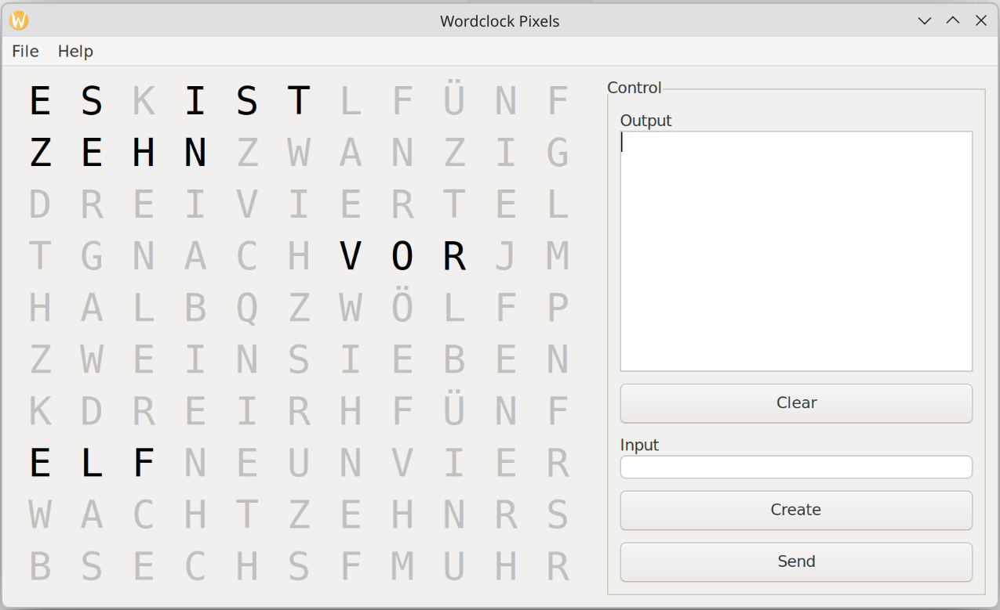

# Wordclock — a German word clock (Wortuhr)

[](https://github.com/theAndreas/Wordclock/actions/workflows/ci.yml)
[](https://github.com/theAndreas/Wordclock/actions/workflows/static-analysis.yml)
[](https://github.com/theAndreas/Wordclock/commits/main)
[](https://github.com/theAndreas/Wordclock/graphs/contributors)

[](platform/)

[](CMakeLists.txt)
[](platform/esp32/platformio.ini)

[](LICENSE)

A word clock based on Arduino — a *Wortuhr*, which is what the German builds of
this idea are called: an 11×10 grid of letters that spells out the time in German
("ES IST FÜNF NACH ZEHN"), with animations, overlays (date, temperature, text)
and a serial command interface.

The same firmware drives WS2812 LEDs from an ESP32-S3, a Raspberry Pi Pico 2 W
(RP2350) or an AVR128DA48, and on the first two a phone configures it over WiFi:
two pages the clock serves itself, NTP time with a time zone, automatic
brightness from a light sensor, and firmware updates over the air.



The whole firmware runs on a PC as well: the simulator draws the matrix in a
window and routes the serial interface to the text boxes beside it, so commands
can be sent and answers read without any hardware. Above it shows 16:20, which
German says as *zehn vor halb fünf* — ten before half five, the kind of wording
the word tables have to cover.

## What it does

- **Time in words** — an 11×10 German letter matrix, driven from a font table the
  clock reads at runtime.
- **Boards** — ESP32-S3, Raspberry Pi Pico 2 W (RP2350), AVR128DA48: one firmware,
  one core, three backends.
- **LEDs** — WS2812 / NeoPixel, shaped by the RMT peripheral on the ESP32 and by
  the CCL on the AVR.
- **Configuration** — a web panel and a command console the clock serves itself
  over WiFi, and the same commands over the serial port.
- **Time source** — NTP with a time zone on the networked boards, a DS3231 on the AVR.
- **Brightness** — automatic, from a BH1750 light sensor, with a night switch.
- **Updates** — over the air, from the panel, on the networked boards.
- **No hardware needed** — the simulator runs the whole firmware on a PC and serves
  the same pages a clock does.

## Auf Deutsch

Eine Wortuhr, die die Zeit in deutschen Worten anzeigt — 11×10 Buchstaben,
WS2812-LEDs, Konfiguration per Handy über WLAN, Update over the air. Die
Firmware läuft auf ESP32-S3, Raspberry Pi Pico 2 W und AVR128DA48, und ohne
Hardware im Simulator auf dem PC. Die Dokumentation ist englisch, die Uhr
spricht deutsch.

## Repository layout

| Directory | Purpose |
|-----------|---------|
| [src/](src/) | **Single source of truth** for the clock logic — platform-agnostic (animations, clock, display, scheduler, overlays, communication). |
| [test/](test/) | The regression tests of the core, built against the simulator's backend and run without a display, and the [fuzzers](test/fuzz/) of the two ways data from outside reaches it. |
| [docs/](docs/) | Reference documentation: the [serial command reference](docs/serial-commands.md), the [font tables](docs/fonts.md), the [roadmap](docs/roadmap.md) of what is still open, the [comparison](docs/comparison.md) with the other published word clocks, the [measured decisions](docs/decisions.md) and how the code is [documented](docs/documentation.md). |
| [assets/](assets/) | The icon's SVG masters and the script that generates the `.ico`, the `.xpm` and `docs/images/logo.png` from them. |
| [web/](web/) | The two pages a networked clock serves: the panel at `/` for what is changed often, the console at `/console` for every command. Compiled into the firmware by [platform/scripts/embed_web.py](platform/scripts/embed_web.py) — the clock has nowhere to fetch anything from. See its [README](web/README.md). |
| [platform/simulator/](platform/simulator/) | wxWidgets desktop backend: renders the matrix in a window so the firmware can be developed and debugged on a PC. |
| [platform/esp32/](platform/esp32/) | On-device backend: WS2812 over the RMT peripheral, time from NTP. Built with PlatformIO — see its [README](platform/esp32/README.md). |
| [platform/rp2350/](platform/rp2350/) | On-device backend for the Raspberry Pi Pico 2 W, derived from the ESP32 one. Built with PlatformIO — see its [README](platform/rp2350/README.md). |
| [platform/arduino/](platform/arduino/) | What the two Arduino backends share: the real-time clock on the system clock, and the BH1750 and DS3231 drivers, written once against `Wire`. Each backend opens the bus its core's way in its own `I2cBus.cpp`. |
| [platform/avr-dx/](platform/avr-dx/) | On-device backend for the AVR128DA48: WS2812 shaped by the CCL, time from a DS3231. Built with CMake and a cross toolchain file — see its [README](platform/avr-dx/README.md). |
| [tools/](tools/) | [documented-sizes.py](tools/documented-sizes.py), which compares every size this repository claims against a build and fails the pull request that made one stale; beside it the template's scripts, [tidy.sh](tools/tidy.sh), [self_contained_headers.py](tools/self_contained_headers.py), [coverage.sh](tools/coverage.sh) and [fuzz.sh](tools/fuzz.sh) among them, which `tools/project.sh` tells what Wordclock is. |

The tool that generates the bitmap font tables lives in its own repository,
[theAndreas/FontCreator](https://github.com/theAndreas/FontCreator) — see
[docs/fonts.md](docs/fonts.md) for the table format and how to regenerate one.

## Architecture

The firmware core reaches the hardware **only through header names**
(`Arduino.h`, `Pixels.h`, `RealTimeClock.h`, `BH1750.h`, `DS3231.h`, `Storage.h`, `System.h`,
`PowerSwitch.h`), resolved via the include path. Each platform under `platform/` supplies those headers with its own
implementation — a compile-time swap with no runtime cost. See
[platform/avr-dx/README.md](platform/avr-dx/README.md) for the contract.

## Building

The quickest way needs nothing installed but VS Code: open the repository, run
**Dev Containers: Reopen in Container** and pick the configuration matching the
host — **Linux/X11** on native Linux, **WSL2/WSLg** when VS Code runs in WSL2.
The container brings the toolchain and wxWidgets, CMake configures on open, and
the WSLg configuration forwards the GUI to the Windows desktop without an extra
X server. See [.devcontainer/README.md](.devcontainer/README.md) for what the
configurations share, how to add a site-specific one on an internal base image,
and why changing the shared settings needs a container rebuild.

Without a container the same works, through the presets of
[CMakePresets.json](CMakePresets.json) - one per platform and kind of build, and what CI
calls as well:

```bash
cmake --workflow --preset default      # configure, build, test - into build/host/
./build/host/bin/Wordclock
cmake --list-presets=all               # avr, clang, sanitize, coverage, fuzz, ci-*
```

Or through the [Makefile](Makefile), which is the index over the presets and everything that
is not CMake: `make` lists every target, `make tests` is the line above, `make run` starts
the window, and `make check` is everything CI runs.

That way requires CMake ≥ 3.25 for the presets, Ninja, a C++17 compiler and wxWidgets 3.x
(GTK on Linux). Without the presets the platform is the `PLATFORM` switch,
`-DPLATFORM=simulator` by default. See the [simulator README](platform/simulator/README.md) for details.

The on-device platforms are not built with CMake. The `esp32` and `rp2350` platforms use
PlatformIO:

```bash
pio run -t upload -d platform/esp32
pio device monitor -d platform/esp32

pio run -t upload -d platform/rp2350     # hold BOOTSEL on the first upload
```

The `avr-dx` platform uses the same CMake, but cross-compiles — so its toolchain
has to be named when the build directory is created, because a compiler cannot be
swapped afterwards. Its preset does that, and its tests are the documented sizes and the
stack, checked against the image just built:

```bash
cmake --workflow --preset avr          # into build-avr/
cmake --build --preset avr --target flash
```

### The two web pages

The pages in [web/](web/) need a clock behind them to show anything, and **the simulator is
one**: it serves them itself, on localhost, from the binary that draws the window.

```bash
cmake --build --preset default && ./build/host/bin/Wordclock     # http://localhost:8080/
```

The panel is at `/` and the console at `/console`, answered out of the same
[`WebFrontend`](src/Communication/WebFrontend/WebFrontend.h) a clock answers them
from — so what the browser sees is what a clock would send, with no board and no second
process. The window and the browser then show the same clock, which is worth more than either
alone: the window is colour-accurate, the pages are what somebody actually uses.

`/update` is answered too, and honestly: nothing is installed, because a desktop has no second
partition — what it stands in for is the panel's progress and its two outcomes, which is the
part of that card nothing else can reach without a board.

There used to be a second way, `platform/esp32/test/run.sh serve`, which put node in front of
a host build of the ESP32 backend. It is gone: node did all the HTTP and the web socket there,
so what it exercised was the pages and the firmware core — exactly what the simulator now does
with one binary and a real server.

## Checks

Every pull request runs two workflows, and the two badges above say separately
whether the code builds and whether it reads clean.

[`.github/workflows/ci.yml`](.github/workflows/ci.yml) is the six ways this
repository can be built, each of which breaks on its own, and the host builds once more
with clang:

| Job | `make` | What it does |
|-----|--------|--------------|
| Simulator and core tests | `tests` | Configures and builds the wxWidgets backend with `-Werror` and runs `ctest` |
| Host builds with clang | `clang host-clang` | The simulator, its tests and both backends' host suites again, compiled by clang with `-Werror` |
| Web pages in a browser | `web` | [`tools/web-smoke.py`](tools/web-smoke.py): the panel and the console in Chromium against the simulator, at 390 and 1280 px — no console error, nothing wider than the window, a command typed in the console answered |
| ESP32 backend on the host | `host-esp32` | [`platform/esp32/test/run.sh`](platform/esp32/test/run.sh) — the backend against the stand-ins in `test/stubs`, no board needed |
| RP2350 backend on the host | `host-rp2350` | [`platform/rp2350/test/run.sh`](platform/rp2350/test/run.sh) — the same arrangement for the Pico's backend |
| ESP32 firmware | `esp32` | `pio run` for the board it actually runs on, and the sizes its README states against the image |
| RP2350 firmware | `rp2350` | `pio run` for the Pico 2 W, and the sizes its notes state |
| AVR Dx firmware | `avr` | The cross build with `-Werror`, plus [`tools/documented-sizes.py`](tools/documented-sizes.py) against the image it just produced, and `make stack`, the template's [`tools/stack.sh`](tools/stack.sh): the deepest stack against the RAM the image leaves free |

A firmware job looks redundant next to its host tests and is not: those compile
the same sources with the host's compiler and libc, so anything the target's
toolchain has a different opinion about passes them. `timegm`, which newlib does
not declare, broke the firmware while every host test stayed green. That argument
carries furthest for the AVR, an 8-bit freestanding target with more opinions than
either of the others.

[`.github/workflows/static-analysis.yml`](.github/workflows/static-analysis.yml)
is what reads the code rather than building it — two analysers, because they are
good at different things, a report of what the tests reach, the tests run again
under the sanitizers, and a fuzzer for what no test thought of:

| Job | `make` | What it does |
|-----|--------|--------------|
| clang-tidy | `tidy tidy-host-suites` | The template's [`tools/tidy.sh`](tools/tidy.sh): each target of [`tools/project.sh`](tools/project.sh) through its own compile database - the AVR's from CMake, the ESP32's and the RP2350's from PlatformIO - then the tests with the simulator, then the fuzzers. Which checks and why the others are off is in [`.clang-tidy`](.clang-tidy). The names alone are also checked in the backends' host tests, through the database their `run.sh compiledb` writes |
| Headers | `headers` | Every header of `src/` and `platform/` compiled on its own, by each target's compiler and the host's, through [`tools/self_contained_headers.py`](tools/self_contained_headers.py) |
| coverage | `coverage` | Builds the core tests and both host suites with `--coverage`, runs them, and fails if together they reach less of the lines, branches and conditions of `src/` than `COVERAGE_MINIMUM` of [`tools/project.sh`](tools/project.sh) says; a table of what none of them runs goes into the job's summary. Through the template's [`tools/coverage.sh`](tools/coverage.sh), which takes the host suites from `coverage_suites()` |
| sanitizers | `sanitize host-sanitize` | The same three suites built with AddressSanitizer and UndefinedBehaviorSanitizer, so that a test which passes only because the host did what undefined behaviour happened to do fails instead |
| fuzz | `fuzz` | libFuzzer, under the same two sanitizers, over the two ways data from outside reaches the firmware: a command line as a browser's web socket frame brings it, and a stored settings blob. Three minutes each per pull request, from a corpus the runs before left in the cache. The fuzzers are in [`test/fuzz/`](test/fuzz/), their options beside them, and [`tools/fuzz.sh`](tools/fuzz.sh) runs them |
| cppcheck | `cppcheck` | Parses the tree by itself, which is what reaches the template instantiations and container bounds the clang checks do not follow. Its two suppressions and their reasons are in [`.cppcheck-suppressions`](.cppcheck-suppressions) |
| Style and scripts | `lint` | The template's [`tools/lint.sh`](tools/lint.sh): clang-format and the indentation of the Doxygen blocks, cpplint with what [`CPPLINT.cfg`](CPPLINT.cfg) filters and why, shellcheck over every shell script, ruff over every Python one and actionlint over the workflows. `make fmt` formats in place. ruff runs pyflakes' checks only, for the reason [`pyproject.toml`](pyproject.toml) gives; actionlint learns the runner label from [`.github/actionlint.yaml`](.github/actionlint.yaml) |
| Web page linters | `web-lint` | [html-validate](https://html-validate.org/) over both pages as whole documents and eslint over the scripts inline in them, at the versions [`package-lock.json`](package-lock.json) pins. What each checks and leaves out is in [`.htmlvalidate.mjs`](.htmlvalidate.mjs) and [`eslint.config.mjs`](eslint.config.mjs) |

cppcheck reads `src/` only: without wxWidgets' own headers it stops at
`DECLARE_EVENT_TABLE` in the simulator's window class, which is the half
clang-tidy already covers through the compile database.

Each job is a target of the [Makefile](Makefile), the template's, or of [tools/project.mk](tools/project.mk),
Wordclock's own, and the workflows run nothing else, so the column above is also what to type
before pushing. Nothing in them needs a display, a board,
or anything the dev container does not carry. The Doxygen blocks are `docs`:

```bash
make lint                     # clang-format, cpplint, the scripts: seconds, no build
make tidy                     # clang-tidy over every target, the tests and the fuzzers
make check                    # every job of both workflows, warnings as errors
make fuzz FUZZ_SECONDS=300    # longer than the three minutes a pull request gets
```

The fuzzers go on from the corpus the run before left in `build/fuzz/work`.

## License

[GPL-3.0-or-later](LICENSE) — Copyright (c) 2017-2026 Andreas Burnickl, the licence
of Utl and MaxMatrix as well. The dependencies the firmware links against keep their
own licences, and each of them may be combined with the GPL: the Arduino cores are
LGPL-2.1, ESPAsyncWebServer is LGPL-3.0-or-later and wxWidgets carries the wxWindows
Licence. None of them is redistributed here; PlatformIO and CMake fetch them at
build time. A release carries the source of its tag beside the firmware, as GitHub
attaches it to every release.
